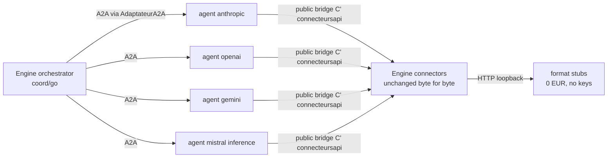

# Mission report M-COORD-LLM-04 — Wiring Anthropic, OpenAI and Gemini into the shared A2A agent server

Copyright © 2026 Denis Bouzon · ORCID <https://orcid.org/0009-0007-8894-8902> · License Apache-2.0

Mission: issue [#56](https://github.com/dbouzon/osnias-clearing/issues/56) (COORD v1.5)
Executor: Mistral · Technical direction, review and acceptance: OpenAI · Pilot: Denis Bouzon
Branch: `mission/coord-llm-04` · Head after T5: `14e0edf68ca6e144adc32163ed6132be4b73757b`

## 1. Summary

Anthropic, OpenAI and Gemini are wired into the SAME shared A2A agent
server as Mistral (M-COORD-LLM-03), INFERENCE-only: no duplicated rail
code, no real call, no key, 0 EUR. The central decision is variant
**C' : PUBLIC ALIAS BRIDGE** (accepted by OpenAI at the mid-T2 review):
the engine package `coord/go/internal/connecteurs` is UNCHANGED byte
for byte (verified against the pinned codeload tarball), and the new
package `coord/go/connecteursapi` re-exports aliases and wrappers for
the real engine types inside the `coordengine` module — the
`coord/a2a-agent` module imports them through
`replace coordengine => ../go`. The T5 cross-qualification exercises
**12 ordered couples** (4 providers × 3, executor ≠ recipient), each
couple running the full cycle: plan critique → simulated execution →
submission → A_CORRIGER → correction → ACCEPTED → ACK received (closure
refused outside the pilot). **12/12 PASS.** REAL qualification (provider
network, keys, B1..B5) remains NOT_EXECUTED and out of scope.

## 2. Decisions and reviews

- **Plan v1**: PLAN_ACCEPTED by OpenAI on round 1 (fingerprint
  `f8d6f348…`, session file recorded in the issue).
- **Mid-T2 arbitration (option C')**: among the three sharing options
  (A duplication, B interface only, C common library), variant C' was
  chosen with OpenAI: the engine is not modified; the additive
  `connecteursapi/pont.go` exposes `Config`, `ConfigFournisseur`,
  `Autorisation`, `HTTPEndPoint`, `AnthropicPoint`, `Resultat`,
  `ConnecteurReel` and a `ChargerConfig` wrapper. Byte-exact engine
  fidelity checked against the codeload tarball at the SHA.
- **T3 OpenAI intermediate review**: COMPLIANT on round 1, no fix. The
  two documented limits below (§6) were accepted.
- **Inference-only Mistral agent is DISTINCT**: the T5 matrix uses
  `-fournisseur mistral` (inference path, existing stop-one profile)
  added to the generic provider map; the historic TWO-WAY Mistral agent
  (`-jeton`, VOIE:API + VOIE:VIBE) is NOT touched (`-demo-local`
  unchanged, identical output).

## 3. Deliverables (branch `mission/coord-llm-04`)

Engine side (`coord/go`, + `coord/a2a`):

| File | Kind | Content |
| --- | --- | --- |
| `go/connecteursapi/pont.go` | NEW (T2) | Public alias bridge: re-exported connector types + `ChargerConfig` wrapper, no duplicated logic |
| `coord/a2a/factices.go` | MODIFIED (additive) | `CarteAgent`, `DemarrerAgentFacticeCarte` + shared helper; `DemarrerAgentFactice` unchanged (delegates with nil map) |
| `go/internal/a2a/agents_llm04_test.go` | NEW (T5) | 12-couple matrix: builds the `coord-agent` binary, spawns 4 listening agents (`AGENT_PRET`), engine A2A adapters, full cycles |

Agent module (`coord/a2a-agent`, `go.mod`: `require coordengine` + `replace => ../go`):

| File | Kind | Content |
| --- | --- | --- |
| `socle/socle.go` | MODIFIED (additive) | `NouveauServeurCarte`: agent server with a parameterisable capability card |
| `agents/inference.go` | NEW (T2) | `ExecInférence`: INFERENCE-only; `VOIE:VIBE` = `CAPACITE_NON_IMPLEMENTEE` (explicit refusal, never a silent simulation); token envelope enforced (`ENVELOPPE_DEPASSEE`); local idempotence key sha256(payload); strict artifact `{"jetons","texte"}` |
| `agents/serveurs.go` | NEW (T2) | `DemarrerServeur`: agent server lifecycle, HONEST Skills card (`coord-inference` only) |
| `agents/factices.go` | NEW (T2/T4) | Stubs per wire format (anthropic / openai+profile): `SCENARIO:` markers carried by the PAYLOAD (DIV_MDL, TRONQUE, SANS_USAGE, 401, 5XX, A_CORRIGER); reception verdicts anchored on the fingerprint extracted from the payload, `verdict_id`/`verdict_url` emitted (FACTICE-LLM04) |
| `agents/inference_test.go` | NEW (T2) | Anchored anthropic acceptance Q3..Q16: Q3 divergent model, Q4 payload without template, Q5 truncation, Q6 missing usage, Q7 401, Q10 rail token required, Q16 VOIE:VIBE refused, full cycle, envelope |
| `agents/tranches_test.go` | NEW (T4/T5) | openai/gemini slices: nominal cycle per slice, non-nominal end per profile (gemini stop-only truncation refused), divergent model, missing usage, unknown reasoning refused AT CALL, gemini default logged at load, honest cards, secrets never transmitted |
| `cmd/coord-agent/agents_llm04.go` | NEW (T2/T5) | Per-provider declarations (anthropic, openai, gemini, mistral-inference), `demarrerAgentFournisseur` (stub + engine connector + server + listen, `AGENT_PRET`), `-demo-llm04` (4 end-to-end wirings, replayable: idempotence registry in a per-run temp directory) |
| `cmd/coord-agent/main.go` | MODIFIED (additive) | Flags `-demo-llm04` and `-fournisseur anthropic\|openai\|gemini\|mistral`; `-demo-local` UNCHANGED |
| `connecteur/Claude/exemple-config-claude.json` · `connecteur/OpenAI/exemple-config-openai.json` | NEW | Example configurations WITHOUT secrets, SIMULATED mode |

Tooling: `.github/workflows/coord-agent-ci.yml` (paths extended to
`coord/go/connecteursapi/**` and `coord/a2a/**`; 3 OS + race on PR).
The engine matrix test triggers `coord-go-ci.yml` (paths `coord/go/**`,
3 OS + race including `./internal/a2a/`).

## 4. Architecture

All agent servers share the SAME server base (`socle.go`, the `coord/a2a`
rail reused without duplication); each agent translates A2A to the
engine connector of ITS wire format (native anthropic, openai,
openai + gemini profile, openai + mistral stop-one profile).

## 5. T5 cross-qualification (12 ordered couples)

- **Bench capacity**: 4 providers, one couple per ordered pair
  executor ≠ recipient = 12 couples, ALL ADMITTED, none NOT_EXECUTED.
- **Full cycle per couple**: plan critique (anchored, PLAN_ACCEPTED
  verdict, mission state unchanged) → simulated execution → submission
  → A_CORRIGER reception (marker carried by the deliverable) →
  EN_CORRECTION → correction → new submission → ACCEPTED → ACK →
  ACK_RECU → `CLOTURE_REFUSEE` outside the pilot.
- **Anti-replay**: a reception verdict without `verdict_id`/`verdict_url`
  is refused by the engine (fail closed); the stubs emit both
  (`FACTICE-LLM04`). The anti-replay line of the engine qualification
  harness (SEC-01, anchored fingerprint, non-conforming deliverable
  rejected without any call) remains covered by the engine harness
  `internal/a2a` + `internal/connecteurs`.
- **Measurements** (sandbox, Go 1.27, Linux): the 12-couple matrix runs
  in 2.61 s → 3.04 s end to end (binary build + 4 spawns + 12 full
  cycles), i.e. ≈ 0.19 s per amortised cycle; `coord-agent` binary
  12.9 MB; a listening agent ≈ 8.1 MB RSS; median rail latency
  unchanged (3.02 ms, measurement #33).
- **Synchronous / asynchronous / cancellation**: CONTRACT UNCHANGED.
  The server executes inside `message/send` (the T3 arbitration of
  M-COORD-LLM-03, accepted by OpenAI); A2A async remains NOT_COVERED
  (contract extension to be validated by both AIs); cancelling an
  `ExecInférence` agent yields a `canceled` event CONFORMING to the SDK
  (never an empty sequence), and the adapter caps follow-up at 20 s.

## 6. Documented limits (accepted at the T3 review)

1. **openai format WITHOUT profile = no end-of-response control**: the
   engine accepts `finish_reason` other than `stop` for the generic
   openai format (engine status quo, pinned by engine tests M1/M2). An
   openai stop-only profile would be an ENGINE change out of the
   mission scope; not done, documented.
2. **Unknown gemini reasoning**: refused AT LOAD if the profile cannot
   validate it (`ChargerConfig`, fail closed), otherwise refused AT
   CALL (`RAISONNEMENT_INCONNU`): defence in depth, never a silent
   acceptance of an unknown parameter.
3. **Real calls and async**: out of scope (order #56). Real
   qualification follows the separate qualification route: triple lock
   (written pilot authorisation, key in the process vault never
   committed, dedicated account), B1..B5 acceptance like Mistral, low
   monetary ceilings from the first request.

## 7. Security and compliance

- 0 EUR, no keys, no provider network: loopback stubs only (SIMULATED
  mode). No example configuration contains a secret; connector error
  messages have secrets scrubbed (shared regular expression); the rail
  token is required (401 otherwise); the idempotence registry refuses
  duplicates (`DOUBLON_REFUSE`, fail closed).
- HONEST capability cards: the inference agent advertises
  `coord-inference` only; `VOIE:VIBE` on an inference agent is REFUSED
  (`CAPACITE_NON_IMPLEMENTEE`), never simulated.
- Merge and closure reserved to the pilot (checked in the matrix:
  `CLOTURE_REFUSEE`).

## 8. Acceptance

Red before green at every slice (tests written against the required
behaviours before the gaps were filled). Full green verified in the
sandbox at SHA `14e0edf6`: `go vet ./...` + `GOOS=windows go vet ./...`
+ `gofmt` on the mission files, `go test ./...` green in both modules
(13 engine packages, 4 agent-module packages), `-demo-llm04`
(4/4 wirings) and `-demo-local` (unchanged) each played twice in a row
(T5 fixed the replayability of the idempotence registry). GitHub CI
(3 OS + race) confirms on the PR.

## 9. Final state

Interaction matrix: **12/12 couples PASS** on the full simulated cycle.
Capability matrix: 4-provider inference OK, Mistral VIBE path only
(explicit refusal elsewhere), honest cards, no secrets, active
duplicate protection. T6 delivery: single PR to `main`, FR/EN reports
(this document and its French original), independent OpenAI acceptance
at the final SHA. Real qualification remains a SEPARATE route subject
to the pilot's written authorisation.
