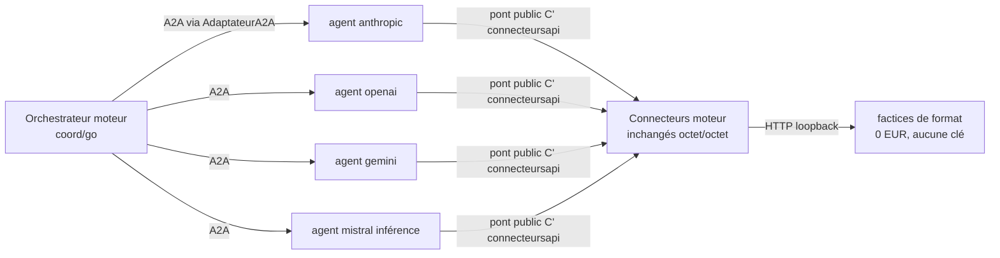

# Rapport de mission — M-COORD-LLM-04 : raccordement Anthropic, OpenAI et Gemini au serveur agent A2A commun

Copyright © 2026 Denis Bouzon · ORCID <https://orcid.org/0009-0007-8894-8902> · Licence Apache-2.0

Mission : issue [#56](https://github.com/dbouzon/osnias-clearing/issues/56) (COORD v1.5)
Exécutant : Mistral · Direction technique, critique et réception : OpenAI · Pilote : Denis Bouzon
Branche : `mission/coord-llm-04` · Tête après T5 : `14e0edf68ca6e144adc32163ed6132be4b73757b`

## 1. Résumé

Les fournisseurs **Anthropic, OpenAI et Gemini** sont raccordés au MÊME
socle serveur agent A2A que Mistral (M-COORD-LLM-03), par la voie
**INFÉRENCE uniquement** : aucun code de rail dupliqué, aucun appel réel,
aucune clé, 0 EUR. L'arbitrage central de la mission est la variante
**C' : PONT PUBLIC D'ALIASES** (acceptée par OpenAI en contrôle mi-T2) :
le paquet moteur `coord/go/internal/connecteurs` est resté **INCHANGÉ
octet par octet** (vérifié par tarball épinglé), et le nouveau paquet
`coord/go/connecteursapi` publie dans le module `coordengine` des
aliases et wrappers vers les types réels du moteur — le module
`coord/a2a-agent` les importe via `replace coordengine => ../go`.
La qualification croisée T5 exerce **12 couples ordonnés** (4
fournisseurs × 3, exécuteur ≠ réceptionnaire), chaque couple parcourant
le cycle complet critique → exécution simulée → soumission →
A_CORRIGER → correction → ACCEPTEE → ACK_RECU (clôture refusée hors
pilote). **12/12 PASS.** La qualification RÉELLE (réseau fournisseur,
clés, B1..B5) reste NON_EXÉCUTÉE et hors périmètre.

## 2. Décisions et contrôles

- **Plan v1** : PLAN_ACCEPTE par OpenAI au tour 1 (empreinte
  `f8d6f348…`, fichier de session consigné dans l'issue).
- **Arbitrage mi-T2 (option C')** : parmi les trois options de
  mutualisation (A duplication, B interface seule, C bibliothèque
  commune), la variante C' a été retenue avec OpenAI : le moteur n'est
  pas modifié, `connecteursapi/pont.go` (additif) expose
  `Config`, `ConfigFournisseur`, `Autorisation`, `HTTPEndPoint`,
  `AnthropicPoint`, `Resultat`, `ConnecteurReel` et un wrapper
  `ChargerConfig`. Fidélité byte-exact du moteur vérifiée au tarball
  codeload au SHA.
- **T3 contrôle intermédiaire OpenAI** : CONFORME au tour 1, sans
  correctif. Les deux limites documentées ci-dessous (§6) ont été
  acceptées.
- **Agent Mistral d'inférence DISTINCT** : la matrice T5 utilise
  `-fournisseur mistral` (voie inférence, profil stop-one existant),
  ajouté à la carte générique des fournisseurs ; l'agent Mistral
  historique **deux voies** (`-jeton`, VOIE:API + VOIE:VIBE) n'est PAS
  touché (démo `-demo-local` inchangée, sorties identiques).

## 3. Livrables (branche `mission/coord-llm-04`)

Côté moteur (`coord/go`, + `coord/a2a`) :

| Fichier | Nature | Contenu |
| --- | --- | --- |
| `go/connecteursapi/pont.go` | NOUVEAU (T2) | Pont public d'aliases : types connecteurs réexportés + wrapper `ChargerConfig`, aucune logique dupliquée |
| `coord/a2a/factices.go` | MODIFIÉ (additif) | `CarteAgent`, `DemarrerAgentFacticeCarte` + helper commun ; `DemarrerAgentFactice` inchangé (délègue avec carte nulle) |
| `go/internal/a2a/agents_llm04_test.go` | NOUVEAU (T5) | Matrice 12 couples : build du binaire `coord-agent`, 4 agents en sous-processus (`AGENT_PRET`), adaptateurs A2A du moteur, cycles complets |

Module agent (`coord/a2a-agent`, `go.mod` : `require coordengine` + `replace => ../go`) :

| Fichier | Nature | Contenu |
| --- | --- | --- |
| `socle/socle.go` | MODIFIÉ (additif) | `NouveauServeurCarte` : socle serveur avec carte de capacités paramétrable |
| `agents/inference.go` | NOUVEAU (T2) | `ExecInférence` : voie INFÉRENCE seule ; `VOIE:VIBE` = `CAPACITE_NON_IMPLEMENTEE` (refus explicite, jamais une simulation silencieuse) ; enveloppe de jetons exigée (`ENVELOPPE_DEPASSEE`) ; clé d'idempotence locale sha256(charge) ; artefact strict `{"jetons","texte"}` |
| `agents/serveurs.go` | NOUVEAU (T2) | `DemarrerServeur` : boucle de vie du serveur agent, carte Skills HONNÊTE (`coord-inference` uniquement) |
| `agents/factices.go` | NOUVEAU (T2/T4) | Factice par format wire (anthropic / openai+profil) : marqueurs `SCENARIO:` dans la CHARGE (DIV_MDL, TRONQUE, SANS_USAGE, 401, 5XX, A_CORRIGER), verdicts de réception ancrés sur l'empreinte extraite de la charge, `verdict_id`/`verdict_url` émis (FACTICE-LLM04) |
| `agents/inference_test.go` | NOUVEAU (T2) | Recette anthropic ancrée Q3..Q16 : Q3 modèle divergent, Q4 charge sans gabarit, Q5 troncature, Q6 usage absent, Q7 refus 401, Q10 jeton du rail exigé, Q16 VOIE:VIBE refusée, cycle complet, enveloppe |
| `agents/tranches_test.go` | NOUVEAU (T4/T5) | Tranches openai/gemini : cycle nominal par tranche, fin non nominale par profil (gemini stop-only tronqué refusé), modèle divergent, usage absent, raisonnement inconnu refusé À L'APPEL, défaut gemini journalisé au chargement, cartes honnêtes, secrets jamais transmis |
| `cmd/coord-agent/agents_llm04.go` | NOUVEAU (T2/T5) | Déclarations par fournisseur (anthropic, openai, gemini, mistral-inférence), `demarrerAgentFournisseur` (factice + point connecteur moteur + socle + écoute, `AGENT_PRET`), démo `-demo-llm04` (4 raccordements de bout en bout, rejouable : registre d'idempotence en répertoire temporaire unique par exécution) |
| `cmd/coord-agent/main.go` | MODIFIÉ (additif) | Drapeaux `-demo-llm04` et `-fournisseur anthropic\|openai\|gemini\|mistral` ; `-demo-local` INCHANGÉ |
| `connecteur/Claude/exemple-config-claude.json` · `connecteur/OpenAI/exemple-config-openai.json` | NOUVEAU | Configurations d'exemple SANS secret, mode SIMULÉ |

Outillage : `.github/workflows/coord-agent-ci.yml` (chemins étendus à
`coord/go/connecteursapi/**` et `coord/a2a/**` ; 3 OS + race sur PR).
Le test matrice moteur déclenche `coord-go-ci.yml` (chemins
`coord/go/**`, 3 OS + race incluant `./internal/a2a/`).

## 4. Architecture

Tous les serveurs agent partagent le MÊME socle (`socle.go`, rail
`coord/a2a` réutilisé sans duplication) ; chaque agent traduit A2A vers
le connecteur moteur de SON format wire (anthropic natif, openai, openai
+ profil gemini, openai + profil mistral stop-one).

## 5. Qualification croisée T5 (12 couples ordonnés)

- **Capacité de banc** : 4 fournisseurs, un couple par paire ordonnée
  exécuteur ≠ réceptionnaire = 12 couples, TOUS ADMIS, aucun NON_EXÉCUTÉ.
- **Cycle complet par couple** : critique de plan (ancre, verdict
  PLAN_ACCEPTE, l'état de mission ne change pas) → exécution simulée →
  soumission → réception A_CORRIGER (marqueur porté par le livrable) →
  EN_CORRECTION → correction → nouvelle soumission → ACCEPTEE → ACK →
  ACK_RECU → `CLOTURE_REFUSEE` hors pilote.
- **Anti-réception** : un verdict de réception sans
  `verdict_id`/`verdict_url` est refusé par le moteur (fail closed) ;
  les factices émettent les deux (`FACTICE-LLM04`). La ligne
  anti-réception du banc de qualification engine (SEC-01, empreinte
  ancrée, livrable non conforme rejeté sans appel) reste couverte par
  le harnais engine `internal/a2a` + `internal/connecteurs`.
- **Mesures** (sandbox, Go 1.27, Linux) : matrice 12 couples
  2,61 s → 3,04 s tout compris (build du binaire + 4 lancements +
  12 cycles complets), soit ≈ 0,19 s par cycle amorti ; binaire
  `coord-agent` 12,9 Mo ; agent en écoute ≈ 8,1 Mo RSS ; latence
  médiane du rail inchangée (3,02 ms, mesure #33).
- **Synchrone / asynchrone / annulation** : CONTRAT INCHANGÉ. Le serveur
  exécute dans `message/send` (arbitrage T3 de M-COORD-LLM-03, accepté
  par OpenAI) ; l'asynchrone A2A reste NON_COUVERT (extension de contrat
  à faire valider par les deux IA) ; l'annulation d'un agent
  `ExecInférence` rend un événement `canceled` CONFORME au SDK (jamais
  une séquence vide), et l'adaptateur borne le suivi à 20 s.

## 6. Limites documentées (acceptées au contrôle T3)

1. **Format openai SANS profil = aucun contrôle de fin de réponse** :
   le moteur accepte `finish_reason` autres que `stop` pour le format
   openai générique (statu quo moteur, figé par les tests engine
   M1/M2). Un profil stop-only openai serait un changement MOTEUR hors
   périmètre de la mission ; non fait, documenté.
2. **Raisonnement gemini inconnu** : refusé au CHARGEMENT si le profil
   ne peut le valider (`ChargerConfig`, fail closed), sinon refusé À
   L'APPEL (`RAISONNEMENT_INCONNU`) : défense en profondeur, jamais
   d'acceptation silencieuse d'un paramètre inconnu.
3. **Appels réels et asynchrone** : hors périmètre (ordre #56). La
   qualification réelle suit la procédure de qualification distincte :
   triple verrou (autorisation écrite du pilote, clé dans le
   trousseau du processus jamais versionnée, compte dédié), recette
   B1..B5 comme pour Mistral, plafonds monétaires bas dès la première
  requête.

## 7. Sécurité et conformité

- 0 EUR, aucune clé, aucun réseau fournisseur : factices loopback
  uniquement (mode SIMULÉ). Aucune configuration d'exemple ne contient
  de secret ; les messages d'erreur du connecteur sont expurgés des
  secrets (expression régulière partagée) ; le jeton du rail est exigé
  (401 sinon) ; le registre d'idempotence refuse les doublons
  (`DOUBLON_REFUSE`, fail closed).
- Cartes de capacités HONNÊTES : l'agent d'inférence annonce
  `coord-inference` uniquement ; `VOIE:VIBE` sur un agent d'inférence
  est REFUSÉE (`CAPACITE_NON_IMPLEMENTEE`), jamais simulée.
- Fusion et clôture réservées au pilote (vérifié dans la matrice :
  `CLOTURE_REFUSEE`).

## 8. Recette

Rouge avant vert à chaque tranche (tests écrits contre les comportements
exigés avant la levée des manques). Vert complet vérifié dans le sandbox
au SHA `14e0edf6` : `go vet ./...` + `GOOS=windows go vet ./...` +
`gofmt` sur les fichiers de la mission, `go test ./...` verts des deux
modules (moteur 13 paquets, module agent 4 paquets), démos
`-demo-llm04` (4/4 raccordements) et `-demo-local` (inchangée)
jouées deux fois de suite (rejouabilité du registre d'idempotence
corrigée au T5). La CI GitHub (3 OS + race) confirme sur la PR.

## 9. État final

Matrice d'interaction : **12/12 couples PASS** au cycle complet simulé.
Matrice de capacités : inférence 4 fournisseurs OK, voie VIBE Mistral
seule (refus explicite ailleurs), cartes honnêtes, secrets absents,
anti-doublon actif. Livraison T6 : PR unique vers `main`, rapports FR/EN
(ce document et sa traduction), réception indépendante OpenAI au SHA
final. La qualification réelle demeure une recette DISTINCTE sur
autorisation écrite du pilote.
